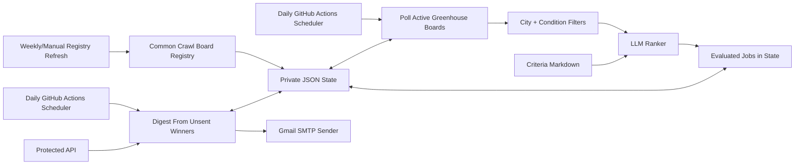

# Job Discovery Newsletter

Job Discovery Newsletter turns scattered job postings into a shortlist tailored to a defined audience. It combines public job-board discovery, configurable filters, and AI-assisted ranking against editable criteria. Originally designed for Schwarzman Scholars, the workflow separates discovery from delivery, tracks previously evaluated opportunities, and supports digest previews before sending.

The package, workflow, and configuration names use OpportunityRadar. The intended deployment described here uses GitHub Actions for discovery and digest jobs, a private repository for durable JSON state, Gmail SMTP for delivery, and Google Groups to manage the audience.

## Current Configuration

The repository includes discovery and ranking code, multiple delivery providers, fixture-backed tests, and local preview scripts. The Gmail SMTP and Google Groups setup below describes the intended deployment; the checked-in defaults differ from it.

| Setting | Application defaults | Daily Gmail setup described below |
| --- | --- | --- |
| Delivery provider | `twilio_whatsapp` | `gmail_smtp` |
| Time zone | `America/Edmonton` | `Asia/Shanghai` |
| Send frequency | Weekly | Daily |
| Send day | Monday (weekly mode only) | Every day |
| Send hour | 09:00 local time | 09:00 local time |

The [workflow](.github/workflows/opportunity-radar-schedule.yml) triggers its send guard at minute 17 of every hour, every day (`17 * * * *`), and defaults `OPPORTUNITY_SEND_FREQUENCY` to `daily`. The application default remains `weekly` for existing deployments outside this workflow. Set the provider, frequency, time zone, and earliest send hour explicitly in repository variables. `OPPORTUNITY_SEND_DOW` applies only in weekly mode.

[Application defaults](src/opportunity_radar/config.py), [Render configuration](render.yaml), and [cost-control guidance](docs/cost-controls.md) retain Twilio-oriented settings or instructions. Review the provider-specific requirements before using them. These checked-in files describe available behavior; they do not verify the live deployment's settings or successful delivery.

## What It Does

- Discovers public Greenhouse boards from Common Crawl and stores reusable board tokens in state.
- Polls active ATS boards daily, normalizes target-city postings, and filters out noisy roles before ranking.
- Uses `docs/opportunity-criteria.md` plus an LLM ranker to decide which roles belong in the digest.
- Requires a focused role before ranking and delivery: go-to-market, strategy/business operations, deployment strategy, or product management with an explicit consulting alternative. Company prestige and legacy broad role groups cannot override this gate.
- Stores evaluated jobs in durable JSON state so the daily digest can send only unsent included opportunities.
- Sends at most one daily plain-text email through Gmail SMTP to a configured Google Group when unsent matches are available.
- Leaves subscriber management, additions, removals, and delivery permissions to Google Groups.
- Provides local scripts, fixture-backed smoke runs, and protected API endpoints for manual checks.

## How It Runs

The app has three scheduled jobs in `.github/workflows/opportunity-radar-schedule.yml`:

| Job | Purpose | Sends email |
| --- | --- | --- |
| Registry refresh | Finds and stores public ATS board tokens. | No |
| Daily discovery | Polls boards, filters/ranks jobs, and writes evaluated state. | No |
| Daily digest | Reads unsent included jobs from state and emails the Google Group. | Yes, when configured |

Manual workflow tasks behave differently:

| Task | What it does |
| --- | --- |
| `all-preview` | Runs registry, discovery, and a digest preview. It never sends email. |
| `registry` | Runs only the registry refresh. |
| `discovery` | Runs only daily discovery. |
| `daily-preview` | Builds today's digest from state without sending. |
| `daily-send` | Checks Gmail SMTP readiness, then sends the digest from state. |

A scheduled daily run sends only when `OPPORTUNITY_SCHEDULER_ENABLED=true`, at or after `OPPORTUNITY_SEND_HOUR` in `OPPORTUNITY_TIMEZONE`. The window stays open until local midnight so delayed runs can catch up. The saved `sent_days` entry prevents another send on that local date, including manual retries. The next day can send new jobs even within the same week. With no unsent matches, the default is to skip an empty email and try again later. Weekly mode still uses `OPPORTUNITY_SEND_DOW` and `sent_weeks`; legacy weekly markers prevent a duplicate on the day daily mode is enabled.

Manual `daily-send` bypasses the time-of-day guard but keeps daily and job duplicate suppression. The workflow accepts the old `weekly-preview` and `weekly-send` task names as aliases; the CLI filename `scripts/run_weekly_digest.py` is retained for compatibility and follows the configured frequency.

Delivery history uses both the source job key and normalized posting/application URLs. Common tracking parameters and Greenhouse host aliases do not make a previously delivered job new. Distinct requisition URLs remain distinct, even when titles match. `evaluated_jobs` records discovery decisions; `sent_jobs` and legacy `seen_jobs` entries with a delivery timestamp record actual delivery. The digest reapplies the role gate to old evaluated records every day.

Before contacting a delivery provider, the sender acquires a one-use `delivery_attempts` claim at the durable store. GitHub uses a SHA-conditional write and checks existing delivery identities on every conflict retry. File storage uses a shared sibling OS lock, read/merge/write and atomic replacement; stale discovery saves retain receipts and holds. A competing job identity or a reused attempt ID cannot authorize another send. Custom stores must implement the atomic `claim_delivery` interface or sending fails closed.

A partial failure, timeout, or failed receipt write leaves those jobs suppressed for all recipients pending operator review. A failed pre-send state write prevents delivery. Review provider receipts before reconciling held jobs; record confirmed deliveries in `sent_jobs` before removing a hold, and release undelivered jobs only after non-delivery is established. Pause all senders and retain a state backup before a manual reconciliation; no automated release or receipt inference is implemented. Keep the file store's sibling `.lock` file in place while any process can access the state. The script never automatically retries held jobs. `--force` bypasses the cadence lock only when sending; `--include-seen` permits repeat jobs only in previews. Previewing does not save delivery state. Successful sends save the final receipts and daily/weekly markers; GitHub state writes merge existing delivery history even on the initial upload.

Use [the focused conditions example](data/config/conditions.example.json) for new configuration. Existing private conditions may further restrict these roles; they cannot broaden the hard gate. For PM roles, an explicit alternative such as "product management or management consulting" or "we welcome candidates from consulting backgrounds" is required. Collaborating with consultants, a consulting bonus alongside mandatory PM experience, and company marketing copy do not qualify. Thin days remain short; minimum-count targets never broaden role eligibility.

## Architecture



## Gmail And Google Groups Setup

Production delivery assumes:

- A Google Group exists for recipients, for example `schwarzman-job-updates@googlegroups.com`.
- The Gmail account used as sender has SMTP access and an app password.
- The Google Group allows the sender address to post to the group.
- GitHub Actions has the repo secrets and variables below.

Use GitHub repository secrets for sensitive values:

```text
OPPORTUNITY_STATE_REPO=<owner/private-state-repo>
OPPORTUNITY_STATE_TOKEN=<fine-grained contents read/write token>
OPPORTUNITY_RECIPIENTS=schwarzman-job-updates@googlegroups.com
OPENROUTER_API_KEY=<capped OpenRouter key>
SMTP_USERNAME=schwarzmanjobupdates@gmail.com
SMTP_APP_PASSWORD=<Gmail app password>
```

Use GitHub repository variables for non-secret settings:

```text
OPPORTUNITY_SCHEDULER_ENABLED=true
OPPORTUNITY_TIMEZONE=Asia/Shanghai
OPPORTUNITY_SEND_FREQUENCY=daily
OPPORTUNITY_SEND_HOUR=9
OPPORTUNITY_SEND_PROVIDER=gmail_smtp
OPPORTUNITY_EMAIL_SUBJECT=Daily Job Newsletter
OPPORTUNITY_MAX_JOBS=30
OPPORTUNITY_MIN_JOBS=15
OPPORTUNITY_MAX_JOBS_PER_COMPANY=2
SMTP_HOST=smtp.gmail.com
SMTP_PORT=587
SMTP_FROM=Schwarzman Job Updates <schwarzmanjobupdates@gmail.com>
SMTP_USE_STARTTLS=true
```

For daily delivery from 09:00 Beijing time, the workflow keeps hourly attempts throughout the week. The local-time guard skips attempts before 09:00; the first eligible cron is 09:17, subject to GitHub delays:

```yaml
- cron: "17 * * * *" # hourly, every day; runtime guard uses Asia/Shanghai
```

The `Check send readiness` and `Run daily digest` schedule checks in the workflow compare `github.event.schedule` to that same cron string. Daily discovery still runs once per day; registry refresh remains weekly.

## Manual Sends

Use manual sends for smoke tests and one-off retries:

1. Open **Actions** -> **OpportunityRadar schedule** -> **Run workflow**.
2. Choose `daily-send`, not `all-preview`.
3. Confirm the run includes the `Check send readiness` step.
4. Confirm Gmail accepted the SMTP send and the Google Group delivered it to members.

`all-preview` and `daily-preview` build previews without emailing the group.

## If Postings Stop

Check the **OpportunityRadar schedule** Actions page first. GitHub automatically
disables scheduled workflows in public repositories after 60 days without repository
activity. Updates in the separate private state repository do not keep this public
repository active. If the page reports inactivity, click **Enable workflow**.

Then run `discovery` and confirm it finishes with `State mutated: True`, followed by
`daily-preview` to inspect the available jobs before a manual send. A green scheduled
run can simply mean `outside_configured_send_window`; it does not prove email delivery.
Look for `Recipients sent: 1/1` in a send run, and confirm Google Group delivery separately.

GitHub can delay or drop scheduled events. The send hour is the earliest allowed
hour, not a guaranteed delivery time. Hourly attempts can recover later on the
local day; a new day's window opens at the configured hour.
`day_already_sent` means today's delivery was already recorded. In weekly mode,
`week_already_sent` means the current week's delivery was already recorded.
The send cron uses minute 17 to avoid the busiest top-of-hour period; see
[GitHub's schedule documentation](https://docs.github.com/en/actions/reference/workflows-and-actions/events-that-trigger-workflows#schedule).

If discovery fails in `GithubJsonStore.save`, inspect the HTTP status and GitHub error
details. State uploads use compact JSON and retry temporary server failures up to three
attempts. A persistent validation error needs investigation before retrying delivery.

See [GitHub's workflow enable/disable documentation](https://docs.github.com/en/actions/how-tos/manage-workflow-runs/disable-and-enable-workflows)
for the inactivity policy and recovery controls.

## State And Config Files

Local development reads from files under `data/` by default. Production can read runtime files from a private GitHub state repo.

| File | Purpose |
| --- | --- |
| `data/config/discovery.example.json` | Common Crawl registry and board-polling limits. |
| `data/config/conditions.example.json` | Posting recency, target locations, role groups, exclude terms, and years-of-experience filters. |
| `data/config/sources.example.json` | Optional explicitly configured sources. |
| `docs/opportunity-criteria.md` | Ranking criteria used by the LLM. |
| `data/state/opportunity-state.json` | Local durable state for development runs. |

Production state repo variables can point to private equivalents with `GITHUB_DISCOVERY_PATH`, `GITHUB_CONDITIONS_PATH`, `GITHUB_SOURCES_PATH`, and `GITHUB_STATE_PATH`.

## Local Development

Install dependencies:

```powershell
python -m pip install -r requirements-backend.txt
```

Run fixture-backed discovery without writing state:

```powershell
python scripts\run_discovery.py --root . --sources tests\fixtures\sources.fixture.json --conditions tests\fixtures\conditions.fixture.json --deterministic-fallback --json
```

Preview a fixture-backed digest without spending model tokens:

```powershell
python scripts\run_weekly_digest.py --root . --sources tests\fixtures\sources.fixture.json --deterministic-fallback --include-seen
```

Write evaluated jobs to local state, then preview the digest from state:

```powershell
python scripts\run_discovery.py --root . --sources data\config\sources.greenhouse-smoke.json --conditions data\config\conditions.example.json --deterministic-fallback --write
python scripts\run_weekly_digest.py --root . --from-state
```

Check Gmail SMTP readiness and send from evaluated state:

```powershell
python scripts\check_send_ready.py --root .
python scripts\run_weekly_digest.py --root . --send --from-state
```

Run the protected API locally:

```powershell
python scripts\serve_backend.py --root . --host 127.0.0.1 --port 8765
```

Preview through HTTP:

```powershell
Invoke-RestMethod -Method Post -Uri http://127.0.0.1:8765/digest/preview -Headers @{ Authorization = "Bearer $env:OPPORTUNITY_API_TOKEN" } -Body '{"from_state":true}' -ContentType 'application/json'
```

## Other Delivery Paths

The codebase includes sender implementations for Gmail SMTP, Gmail API, Microsoft Graph email, and Twilio WhatsApp. This README focuses on the intended Gmail SMTP plus Google Groups deployment. Twilio WhatsApp remains the checked-in default, as described in [Current Configuration](#current-configuration); select the desired provider explicitly.

## Verification

Run the production gate before changing scheduling, delivery, or ranking behavior:

```powershell
python scripts\run_production_gate.py --root .
```

The gate compiles Python, runs unit/integration tests, performs fixture-backed registry refresh, exercises dynamic discovery, and runs digest smoke checks.

## Deployment Notes

`render.yaml` defines only the optional free Render web service. It does not create Render cron services because those can require paid cron billing.

Scheduled work is owned by GitHub Actions. Before enabling live sends on a new deployment, run `daily-send` manually with a test recipient and confirm the Gmail-to-Google-Groups path is ready.

See `docs/cost-controls.md` for budget controls and `docs/private-state-repo-readme.md` for the private state repo layout.
